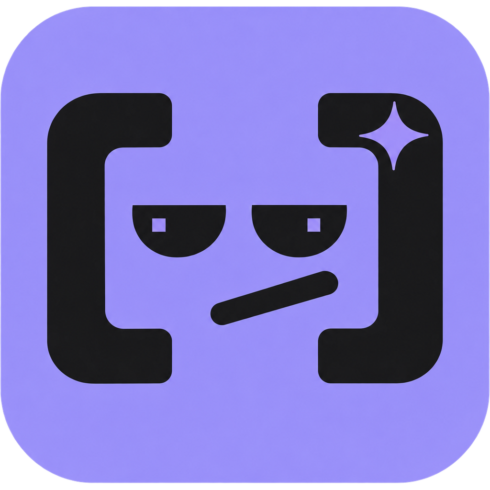

<p align="center"></p>

# DerpMeter for macOS

**How derpy is your AI today?** A menu bar app that shows the community's 24h [Derp Score](https://derpmeter.com) for your coding agent and lets you vote Smart / Meh / Dumb in one click. Optionally, smash a retro CRT on your desktop when the agent lets you down.

Agents: Claude Code, Codex and Antigravity. macOS 14+, Apple Silicon and Intel. MIT licensed.

## Install

```sh
brew install --cask derpmeter/derpmeter/derpmeter
```

Or download the notarized beta from [derpmeter.com/apps](https://derpmeter.com/apps). It is Developer ID signed and notarized by Apple, so it opens normally.

There is nothing to set up. The first vote gets a random menu bar token automatically (no email or account) and keeps it only in your login Keychain.

## Features

- **Score in the menu bar** in the same mood format as the CLI statusline: `(•‿•) · Derp 20`, `(•_•) · Derp 50`, `(⊙_☉) · Derp 80`. Smart is below 35 (green), Meh 35–64 (yellow), Dumb 65+ (red). Low samples, cached or offline data and pause show in the tooltip and panel.
- **Panel:** the three agents' scores, a sentiment scale and Smart / Meh / Dumb buttons, with an optional failure reason. The score is community sentiment, not a capability benchmark.
- **Model choice:** _Auto_ (the detected model), _No model_, or any current catalog model. The choice is remembered per agent and the cooldown follows it.
- **Cooldown countdown:** "Next vote in 37 min" for the selected agent and model; the buttons stay disabled until then.
- **Undo last vote** within 24h (the cooldown still applies).
- **Offline queue:** up to 20 votes for 24h. Each retry sends the same body and key, backing off from 30 s to 1 h. It stops on 401, 409 and 429, never follows redirects and never sends a vote to another server. You can inspect and discard queued votes.
- **Global shortcuts** ⌥⌘1 / ⌥⌘2 / ⌥⌘3 (off by default). They use Carbon hot keys, so no Accessibility or Input Monitoring permission is needed.
- **Notifications** for vote results and for a Derp Score jump of 10+ points with 30+ votes. **Launch at login.**
- **Privacy controls:** pause (no network; votes stay queued) and clear local state. Clearing does not delete votes the server already accepted.

### Derp Smash (optional desktop CRT)

A small retro CRT on your desktop that you can smash with a hammer or a baseball bat. **Off by default.**

- **Turn on:** Settings → Derp Smash, or the panel's `…` menu → _Derp Smash desktop CRT_. Settings also choose the weapon, the size, sound and _Keep above other windows_ (off: the CRT sits just above the desktop icons).
- **Use:** click to smash, drag to move (the spot is remembered per display). Right-click for weapon, repair, agent, size, sound and hide.
- **Damage:** 1–2 hits light, 3–4 heavy, 5 broken. A broken CRT offers an optional _Smart / Meh / Dumb_ prompt with nothing preselected. _Not now_ leaves it broken; _Repair_ resets it.
- **Votes:** only a button you press in the prompt is a vote, sent through the same queue, token and cooldown as the panel. Hits are not votes and never count toward the Derp Score.
- **Light on resources:** no polling; animations run only briefly after a hit or a repair and respect Reduce Motion. The window never takes keyboard focus, needs no special permission and is not shown over full-screen apps or the lock screen.

## What it reads on your Mac

Nothing beyond what you turn on:

| Setting                                                                                                                                          | Reads                                                                                                                                                                              |
| ------------------------------------------------------------------------------------------------------------------------------------------------ | ---------------------------------------------------------------------------------------------------------------------------------------------------------------------------------- |
| Always                                                                                                                                           | Its own cache in `~/Library/Application Support/DerpMeter/` (0600, refreshed every 5 min) and its Keychain item                                                                    |
| _Detect the model_ (off by default)                                                                                                              | Only the model setting of each agent: `model` in `~/.claude/settings.json` (or `$CLAUDE_CONFIG_DIR`), `model` in `~/.codex/config.toml`, `model.name` in `~/.gemini/settings.json` |
| _Use local session observations_ (off by default; also needs `derp privacy session on` in the [CLI](https://github.com/derpmeter/derpmeter-cli)) | Only `~/.derpmeter/observed.json` (agent, model, time). That live Claude Code model wins while fresh, and votes are marked session-linked                                          |

Model detection details:

- Exact ids win, and `[1m]` or date suffixes are ignored.
- Claude aliases (`opus`, `sonnet`, `haiku`, `fable`, `opusplan`) map to the current catalog model of that family.
- Without a `model` key, the agent uses its account default, which no file records, so pick a model yourself.
- Antigravity's Claude and GPT models have DerpMeter-only `agy-*` ids, so pick them manually.

There is no process scanning, no transcript or screen access and no broad file access. Keychain reads never prompt or block startup. If an existing token can't be read, it is kept and the panel shows a notice instead of replacing it.

## Build from source

```sh
swift test                 # DerpCore: vote contract, offline queue, mascot, local integration, API client
swift run                  # run unbundled (notifications and launch at login unavailable)
./scripts/bundle.sh        # build build/DerpMeter.app (ad-hoc signed, hardened runtime)
open build/DerpMeter.app
```

Requires Xcode 15.3+ (Swift 5.10+). No additional entitlements are needed.

QA helpers (own views only, no screen recording):

- `build/DerpMeter.app/Contents/MacOS/DerpMeterCompanion --open-panel` opens the real popover anchored to the status icon.
- `--capture-panel <existing dir>` renders the panel and status button to PNG.
- `.build/debug/DerpMeterCompanion --render-smash <dir>` renders each Derp Smash state to PNG.

Development server: `defaults write com.derpmeter.companion endpoint <origin>`. Run `defaults delete com.derpmeter.companion endpoint` to go back to derpmeter.com.

### Signed release

A notarized build needs a Developer ID Application identity and an existing `notarytool` Keychain profile. No credentials belong in the repository:

```sh
SIGN_IDENTITY="Developer ID Application: <Name> (<TEAMID>)" \
NOTARY_PROFILE="<keychain-profile>" ./scripts/pack.sh
```

`pack.sh` builds a universal app, signs it with hardened runtime, submits it to Apple, staples the ticket, checks Gatekeeper and only then writes the zip. For a release marked `notarized` in `release.json`, it fails before building if signing is not configured. It writes to the website's downloads folder in the monorepo; in this mirror, take the zip from `build/`.

## Uninstall

```sh
brew uninstall --cask derpmeter   # or quit the app and delete it
rm -rf ~/Library/Application\ Support/DerpMeter
defaults delete com.derpmeter.companion
```

Then delete the `com.derpmeter.companion` item in Keychain Access.

## Source

This repository is a read-only mirror of the menu bar app in the DerpMeter monorepo, updated on each release ([derpmeter/derpmeter-menubar](https://github.com/derpmeter/derpmeter-menubar)). Issues are welcome. Pull requests are applied upstream (with credit) and arrive with the next release. Related: [CLI, statusline and MCP server](https://github.com/derpmeter/derpmeter-cli).

Bundled assets keep their own licenses (see [`Resources/README.md`](Resources/README.md)). Provider logos are trademarks of their owners.

MIT © DerpMeter
